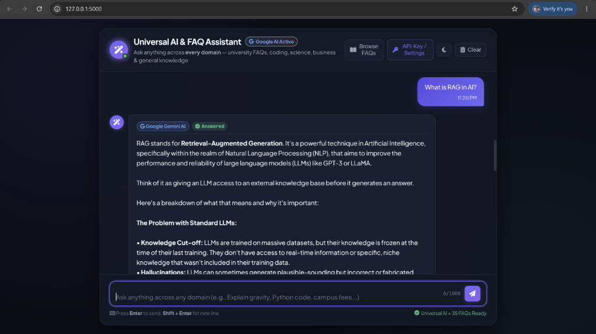
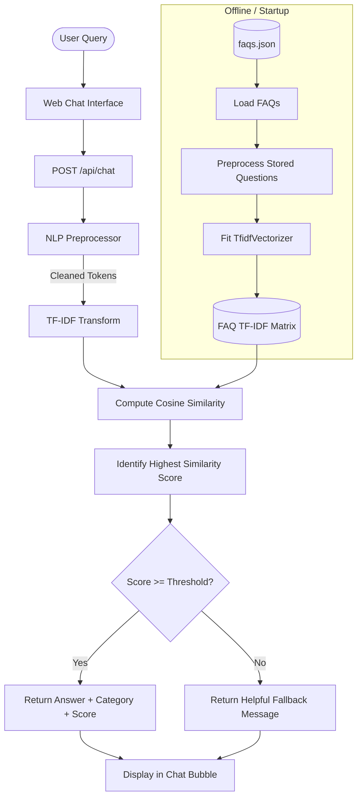

# Universal AI & FAQ Assistant - Multi-Domain Chatbot (Google Gemini + NLP)

An intelligent, full-stack hybrid AI chatbot web application that combines **Natural Language Processing (TF-IDF & Cosine Similarity)** for verified institutional knowledge bases with **Google Gemini AI** to answer questions across **every domain** (programming, science, mathematics, creative writing, history, finance, and general knowledge).

<div align="center">
  <br>
  
  <p><sub><em>Live Application Interface: Universal AI & FAQ Assistant answering a multi-domain AI question ("What is RAG in AI?") powered by Google Gemini.</em></sub></p>
  <br>
</div>

---

## 📋 Table of Contents
1. [Application Interface Preview](#-application-interface-preview)
2. [Project Overview](#-project-overview)
3. [Universal Multi-Domain Support & Google Gemini AI](#-universal-multi-domain-support--google-gemini-ai)
4. [Key Features](#-key-features)
5. [Technology Stack](#-technology-stack)
6. [Architecture & How It Works](#-architecture--how-it-works)
   - [Hybrid Routing Engine](#hybrid-routing-engine)
   - [NLP Preprocessing Pipeline](#1-nlp-preprocessing-pipeline)
   - [TF-IDF Vectorization & Cosine Similarity](#2-tf-idf-vectorization--cosine-similarity)
   - [Google Gemini Integration](#3-google-gemini-integration)
7. [Project Folder Structure](#-project-folder-structure)
8. [Installation & Setup](#-installation--setup)
   - [Configuring Google Gemini API Key](#configuring-google-gemini-api-key)
   - [Windows Setup](#windows-setup)
   - [macOS / Linux Setup](#macos--linux-setup)
9. [Running the Application](#-running-the-application)
10. [REST API Documentation](#-rest-api-documentation)
11. [Customizing FAQs & AI Modes](#-customizing-faqs--ai-modes)
12. [Running Automated Tests](#-running-automated-tests)
13. [Troubleshooting Guide](#-troubleshooting-guide)

---

## 📸 Application Interface Preview

The application features a sleek dark-mode glassmorphic user interface:
- **Header:** Displays live online status, active Google AI badge, and controls for browsing all FAQs, adjusting API keys, toggling dark/light themes, and clearing conversations.
- **Dynamic Response Bubbles:** Renders rich markdown (code blocks, bullet points, bold highlights), category badges, and source attribution (`Google Gemini AI` vs. `Verified FAQ`).
- **Interactive Multi-Domain Suggestions:** Clickable prompt chips for rapid testing across programming, university life, science, and careers.
- **Adaptive Input Area:** Auto-resizing textarea with character counter and keypress shortcuts (Enter to send, Shift+Enter for newline).

---

## 🌟 Project Overview

Traditional FAQ chatbots are rigidly constrained to a small predefined dataset—if a student or user asks a programming question, a science inquiry, or an everyday question outside the dataset, the bot fails with a canned fallback message.

**Universal AI & FAQ Assistant** solves this by implementing a **Hybrid AI Architecture**:
1. **Verified Institutional Knowledge Base:** Instantly retrieves verified college questions (admissions, tuition fees, scholarships, library schedules, campus policies) using local **TF-IDF & Cosine Similarity**.
2. **Universal Google Gemini Intelligence:** Seamlessly routes inquiries across **every other domain** (writing Python code, debugging errors, explaining physics concepts, career advice, historical trivia, etc.) to **Google Gemini AI**.
3. **Flexible API Key Management:** Users can supply their Google Gemini API Key directly in the UI settings (with live API key validation), or administrators can configure it via the `GOOGLE_API_KEY` environment variable / `.env` file.

---

## 🌐 Universal Multi-Domain Support & Google Gemini AI

The assistant is **open for every domain**, including:
- 💻 **Computer Science & Coding:** Python, JavaScript, SQL, algorithms, debugging, regex.
- 🔬 **Science & Engineering:** Quantum physics, biology, chemistry, mechanics, astronomy.
- 📐 **Mathematics & Statistics:** Calculus, probability, linear algebra, geometry.
- 🎓 **Campus Life & Academics:** Admissions criteria, fee schedules, exam dates, hostel rules.
- 💼 **Career & Professional Development:** Resume writing, interview prep, project ideas.
- 🌍 **General Knowledge & Arts:** World history, geography, literature, economics, lifestyle.

---

## ✨ Key Features

- **Semantic NLP Matching:** Uses scikit-learn's `TfidfVectorizer` (unigrams + bigrams) with sublinear TF scaling.
- **Robust Text Preprocessing:** Custom NLTK-driven cleaning pipeline that normalizes punctuation, expands English contractions (e.g., *can't* &rarr; *cannot*), tokenizes, lemmatizes words, and preserves negations (*not*, *no*, *never*).
- **Graceful Offline Fallback:** Includes offline regex tokenization and fallback stop words so the system never crashes even without an active internet connection.
- **Modern Chat Interface:**
  - Responsive, glassmorphic layout.
  - Interactive suggested question chips.
  - Real-time animated typing indicator.
  - Category tags and live confidence percentages.
  - 1-click copy answer to clipboard with feedback toast.
  - Feedback thumbs-up button.
  - Light / Dark theme switcher (saved in `localStorage`).
  - Session preservation (retains messages until cleared).
  - Built-in **FAQ Knowledge Base Explorer** modal to search and test all indexed questions.
  - Real-time **Threshold Tuner** modal with live slider to evaluate matching sensitivity.
- **Production-Ready Flask Backend:** Complete REST API with payload validation, length limits, error handling, and CORS-friendly JSON responses.
- **Automated Test Suite:** Comprehensive unit and integration test suite covering 28 test cases.

---

## 🛠 Technology Stack

| Layer | Technology | Purpose |
|---|---|---|
| **Programming Language** | Python 3.8+ | Core application and NLP engine |
| **Backend Framework** | Flask | RESTful API and static file serving |
| **NLP & Preprocessing** | NLTK | Tokenization, lemmatization, and stopwords |
| **Text Vectorization** | scikit-learn (`TfidfVectorizer`) | Unigram & bigram term frequency-inverse document frequency |
| **Similarity Metric** | scikit-learn (`cosine_similarity`) | Angular similarity between high-dimensional query vectors |
| **Data Storage** | JSON (`faqs.json`) | Modular, easily editable FAQ dataset (35+ college questions) |
| **Frontend** | HTML5, Vanilla CSS3, JavaScript (ES6) | Responsive, high-performance UI without heavy frameworks |
| **Typography & Icons** | Plus Jakarta Sans, Font Awesome 6 | Visual hierarchy and modern aesthetics |

---

## 🧠 Architecture & How It Works



### 1. NLP Preprocessing Pipeline
Text undergoes multi-stage normalization in `chatbot/preprocessing.py`:
1. **Contraction Expansion:** Replaces colloquial contractions (*"what's"* &rarr; *"what is"*, *"can't"* &rarr; *"cannot"*).
2. **Special Character Cleaning:** Strips symbols and punctuation while retaining alphanumeric characters.
3. **NLTK Tokenization:** Splits the text into distinct linguistic tokens using NLTK `word_tokenize` (with regex fallback).
4. **Stop Words Filtering with Negation Preservation:** Removes generic English words (*"the"*, *"is"*, *"at"*), but explicitly retains critical negations (*"not"*, *"no"*, *"never"*, *"cannot"*).
5. **WordNet Lemmatization:** Reduces inflected forms to their dictionary root (e.g. *"scholarships"* &rarr; *"scholarship"*, *"fees"* &rarr; *"fee"*, *"libraries"* &rarr; *"library"*).

### 2. TF-IDF Vectorization & Cosine Similarity
- **TF-IDF (Term Frequency - Inverse Document Frequency)** reflects how important a word or phrase is to a specific question relative to the whole corpus.
- We utilize **unigrams and bigrams** (`ngram_range=(1, 2)`) to capture multi-word compounds like *"tuition fees"*, *"library hours"*, *"student id"*, and *"bus service"*.
- **Cosine Similarity** evaluates the cosine of the angle between the query vector $\mathbf{u}$ and an FAQ question vector $\mathbf{v}$:
  $$\text{Cosine Similarity}(\mathbf{u}, \mathbf{v}) = \frac{\mathbf{u} \cdot \mathbf{v}}{\|\mathbf{u}\| \|\mathbf{v}\|}$$
- The score ranges from `0.0` (orthogonal / zero overlap) to `1.0` (identical direction).

### 3. Thresholding & Fallback Handling
Cosine similarity is a geometric metric rather than a calibrated probability. A question about an unrelated topic (e.g., *"how to bake a cake"*) will yield a score of `0.0` because none of its tokens exist in the college vocabulary.

The application checks the maximum score against a **configurable confidence threshold** (default `0.25`):
- If $\text{Score} \ge 0.25$: The matched answer, question, and category are returned with `matched: true`.
- If $\text{Score} < 0.25$: The engine triggers a polite fallback message with `matched: false`, directing the student to contact the relevant campus department.

---

## 📁 Project Folder Structure

```
Project2/
│
├── app.py                     # Flask web server and REST API endpoints
├── requirements.txt           # Python dependency specifications
├── README.md                  # Comprehensive documentation and guide
├── faqs.json                  # FAQ knowledge base (35+ curated college FAQs)
├── .gitignore                 # Git ignore rules for Python / IDE artifacts
│
├── chatbot/                   # NLP and retrieval package
│   ├── __init__.py            # Package exports
│   ├── preprocessing.py       # NLTK tokenization, cleaning, lemmatization
│   └── faq_engine.py          # TF-IDF indexer and cosine similarity matcher
│
├── templates/
│   └── index.html             # Chatbot UI with modals and semantic HTML5
│
├── static/
│   ├── css/
│   │   └── style.css          # Vanilla CSS design system, dark/light themes
│   └── js/
│       └── script.js          # Chat controller, speech/session handling, API
│
└── tests/                     # Automated testing suite
    ├── __init__.py
    ├── test_faq_engine.py     # NLP pipeline, similarity, and edge case tests
    └── test_api.py            # Flask REST API endpoints and validation tests
```

---

## 💻 Prerequisites & System Requirements

- **Python 3.8 to 3.14**
- **pip** (Python package installer)
- Operating System: Windows 10/11, macOS, or Linux
- Standard modern web browser (Chrome, Edge, Firefox, Safari)

---

## 🚀 Installation & Setup

### Configuring Google Gemini API Key

You can configure your Google API Key in either of two ways:

1. **Option A: In the Web User Interface (Easiest)**
   - Open the chatbot in your browser.
   - Click **API Key / Settings** (or the Google AI badge in the top header).
   - Paste your key and click **Validate & Save**. The frontend validates the key directly with Google and unlocks all domains immediately!

2. **Option B: Via `.env` File or Environment Variable**
   - Copy `.env.example` to `.env`:
     ```powershell
     cp .env.example .env
     ```
   - Add your key:
     ```env
     GOOGLE_API_KEY=AIzaSy...your_actual_key_here
     ```
   - Or set it in your terminal before launching:
     ```powershell
     # Windows PowerShell
     $env:GOOGLE_API_KEY="AIzaSy..."
     ```
     ```bash
     # macOS / Linux
     export GOOGLE_API_KEY="AIzaSy..."
     ```

> **Where to get a key:** You can get a free Google Gemini API key at [Google AI Studio](https://aistudio.google.com/app/apikey).

---

### Windows Setup

1. **Open PowerShell or Command Prompt** and navigate to the project directory:
   ```powershell
   cd c:\Users\Dattaprasad\Desktop\CodeAlpha\Project2
   ```

2. **(Optional but recommended) Create and activate a virtual environment:**
   ```powershell
   python -m venv venv
   .\venv\Scripts\Activate.ps1
   ```
   *(If PowerShell gives an execution policy error, run `Set-ExecutionPolicy -Scope Process -ExecutionPolicy Bypass` first).*

3. **Install required dependencies:**
   ```powershell
   pip install -r requirements.txt
   ```

4. **Download NLTK corpora (automatic on first run, or run manually):**
   ```powershell
   python -c "import nltk; nltk.download('punkt_tab'); nltk.download('stopwords'); nltk.download('wordnet')"
   ```

---

### macOS / Linux Setup

1. **Open Terminal** and navigate to the project folder:
   ```bash
   cd /path/to/Project2
   ```

2. **Create and activate a virtual environment:**
   ```bash
   python3 -m venv venv
   source venv/bin/activate
   ```

3. **Install dependencies:**
   ```bash
   pip install -r requirements.txt
   ```

4. **Verify NLTK packages:**
   ```bash
   python3 -c "import nltk; nltk.download('punkt_tab'); nltk.download('stopwords'); nltk.download('wordnet')"
   ```

---

## ⚡ Running the Application

Start the Flask development server:

### Windows:
```powershell
python app.py
```

### macOS / Linux:
```bash
python3 app.py
```

You should see output similar to:
```
2026-10-17 22:38:58 [INFO] FAQAssistant: Initializing NLTK resources and FAQ Engine...
2026-10-17 22:38:58 [INFO] FAQAssistant: Loaded 35 FAQs with threshold 0.25
Starting FAQ Assistant Server on http://127.0.0.1:5000
 * Serving Flask app 'app'
 * Debug mode: on
 * Running on http://127.0.0.1:5000
```

Open your browser and navigate to:
👉 **`http://127.0.0.1:5000`**

---

## 📡 REST API Documentation

### 1. Match Question
- **URL:** `/api/chat`
- **Method:** `POST`
- **Headers:** `Content-Type: application/json`
- **Body:**
  ```json
  {
    "message": "How can I apply for admission?",
    "threshold": 0.25
  }
  ```
- **Success Response (200 OK):**
  ```json
  {
    "answer": "You can apply for admission online through the university admissions portal by filling out the application form, uploading the required academic transcripts, and paying the application fee.",
    "category": "Admissions",
    "confidence": 1.0,
    "matched": true,
    "matched_question": "How can I apply for admission?"
  }
  ```
- **Fallback Response (200 OK):**
  ```json
  {
    "answer": "I'm sorry, I couldn't find a reliable answer to that question. Please try rephrasing it or contact the appropriate college department.",
    "category": null,
    "confidence": 0.0,
    "matched": false,
    "matched_question": null
  }
  ```
- **Error Response (400 Bad Request):**
  ```json
  {
    "error": "Message cannot be empty or contain only whitespace."
  }
  ```

---

### 2. Get FAQ Knowledge Base Summary
- **URL:** `/api/faqs`
- **Method:** `GET`
- **Query Parameters:** `category` (optional, filter by specific category)
- **Response (200 OK):**
  ```json
  {
    "total": 35,
    "categories": [
      "Admissions",
      "Application Deadlines",
      "Attendance Requirements",
      "Class Schedules",
      "Contact Information",
      "Courses and Programs",
      "Examination Dates",
      "Hostel Facilities",
      "Library Hours",
      "Refund Policies",
      "Scholarships",
      "Student ID Cards",
      "Technical Support",
      "Transportation",
      "Tuition Fees"
    ],
    "suggested_questions": [
      {
        "category": "Admissions",
        "question": "How can I apply for admission?"
      }
    ],
    "faqs": [
      {
        "id": 1,
        "category": "Admissions",
        "question": "How can I apply for admission?"
      }
    ]
  }
  ```

---

### 3. Server Health Status
- **URL:** `/api/health`
- **Method:** `GET`
- **Response (200 OK):**
  ```json
  {
    "faqs_loaded": 35,
    "service": "FAQ Assistant API",
    "similarity_threshold": 0.25,
    "status": "healthy",
    "version": "1.0.0"
  }
  ```

---

## 📝 Customizing FAQs

To add, edit, or remove FAQs, simply open `faqs.json`. Each item is structured as follows:

```json
{
  "id": 36,
  "category": "Placement",
  "question": "Does the college offer campus placement assistance?",
  "answer": "Yes, the Career Guidance and Placement Cell conducts annual recruitment drives with top industry partners starting in the final year."
}
```

The next time `app.py` is started (or upon file reload), the FAQ Engine will automatically re-index all questions and regenerate the TF-IDF matrix.

---

## 🎚 Tuning the Similarity Threshold

The default threshold is **`0.25`**. 

1. **Via Web Interface:**
   - Click the **Settings icon** (`⚙` / sliders) in the top header.
   - Adjust the slider between `0.10` (lenient) and `0.80` (strict).
   - Click **Apply Settings**. The chatbot will now test matches against your chosen threshold.

2. **Via Environment Variable:**
   ```powershell
   # Windows PowerShell
   $env:SIMILARITY_THRESHOLD="0.30"; python app.py
   ```
   ```bash
   # macOS / Linux
   SIMILARITY_THRESHOLD=0.30 python3 app.py
   ```

3. **In Code:**
   In `app.py` or `chatbot/faq_engine.py`:
   ```python
   faq_engine = FAQEngine(faq_file_path="faqs.json", similarity_threshold=0.30)
   ```

---

## 🧪 Running Automated Tests

Run the full test suite using Python's built-in `unittest` runner:

```powershell
# Windows
python -m unittest discover -s tests -v
```

```bash
# macOS / Linux
python3 -m unittest discover -s tests -v
```

### Test Coverage Highlights (28 Tests):
- **Exact question match** &rarr; confidence 1.0, correct answer.
- **Paraphrased questions** &rarr; matched correctly with semantic overlap.
- **Case insensitivity** &rarr; matching irrespective of uppercase/lowercase.
- **Extra punctuation and whitespace** &rarr; cleaned cleanly.
- **Unrelated queries (e.g. cake recipes, celestial distance)** &rarr; score 0.0, fallback triggered.
- **Empty input, missing fields, and non-string types** &rarr; 400 Bad Request.
- **Malformed and missing FAQ datasets** &rarr; explicit error handling.
- **Length limit enforcement** &rarr; queries > 500 characters rejected.
- **Configurable threshold verification** &rarr; strict threshold rejects low similarity queries.

---

## 💡 Example Questions to Test

| Query Category | Example User Query | Expected Behavior |
|---|---|---|
| **Exact Match** | `How can I apply for admission?` | Matched (Confidence: 100%) |
| **Paraphrase** | `What is the cost of tuition fees?` | Matched with Fee FAQ |
| **Schedule** | `What are the library hours?` | Matched with Library FAQ |
| **Attendance** | `What is the college attendance policy?` | Matched with Attendance FAQ |
| **Card Issue** | `I lost my student ID card, what do I do?` | Matched with ID Card FAQ |
| **Hostel** | `Are hostel accommodations available?` | Matched with Hostel FAQ |
| **Transport** | `Can you tell me about the bus service?` | Matched with Transport FAQ |
| **Unrelated** | `How do I bake a chocolate cake?` | **Fallback:** Polite department referral |
| **Unrelated** | `What is the capital of Mars?` | **Fallback:** Polite department referral |

---

## 🔧 Troubleshooting Guide

| Issue | Cause | Solution |
|---|---|---|
| `LookupError: Resource punkt_tab not found` | NLTK tokenization resource missing | Run `python -c "import nltk; nltk.download('punkt_tab'); nltk.download('stopwords'); nltk.download('wordnet')"` |
| `FileNotFoundError: faqs.json` | Running python command from wrong directory | Ensure your terminal's current working directory is the project root containing `faqs.json`. |
| Port 5000 already in use | Another application is listening on port 5000 | Set another port: `PORT=5001 python app.py` (or `$env:PORT=5001` in PowerShell). |
| Unrelated question gets matched | Threshold set too low or stopwords not filtered | Keep threshold at &ge; 0.25 and verify question stopwords are removed. |
| UI messages don't appear | JavaScript blocked or connection lost | Open browser Developer Tools (F12) &rarr; Console to check API network errors. |

---

## 📜 License & Academic Attribution
This project was built for educational and portfolio demonstration purposes as part of the CodeAlpha Internship Program. Feel free to use and adapt this architecture for your academic and production NLP projects.
